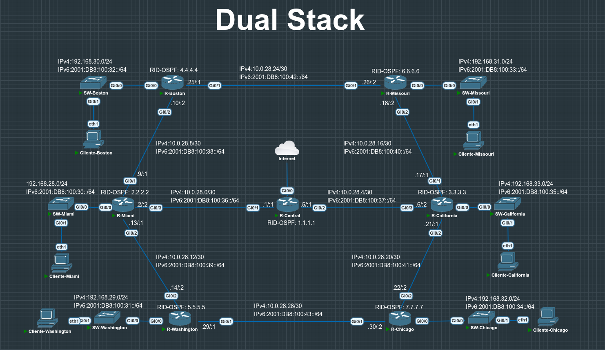
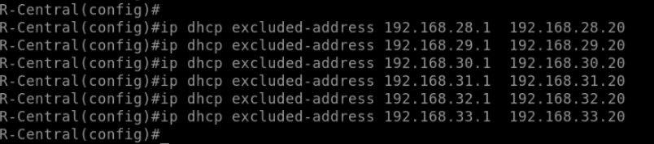
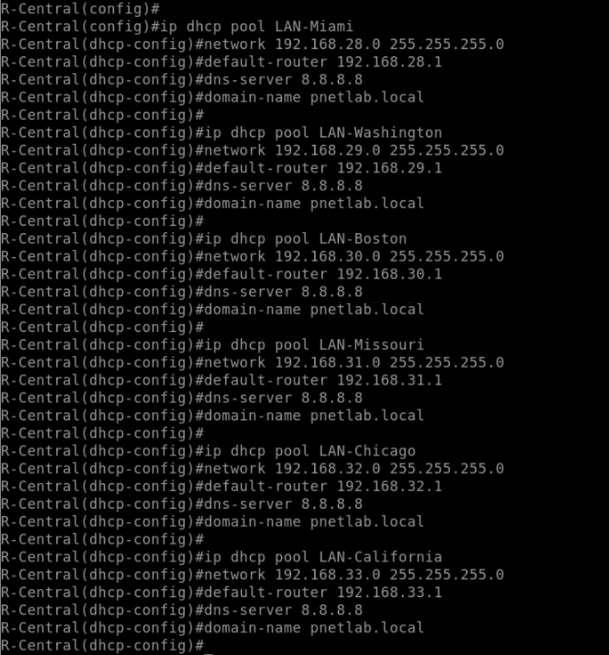
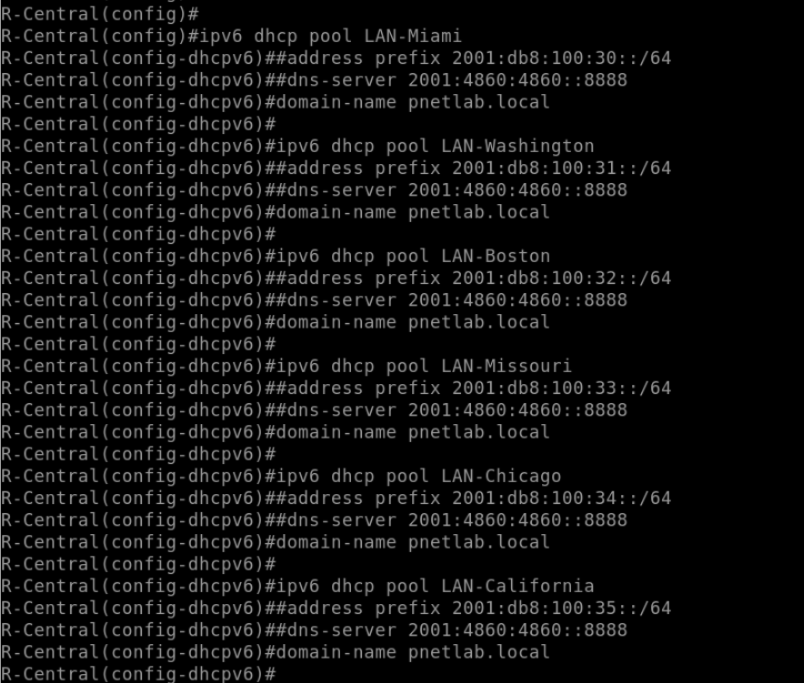
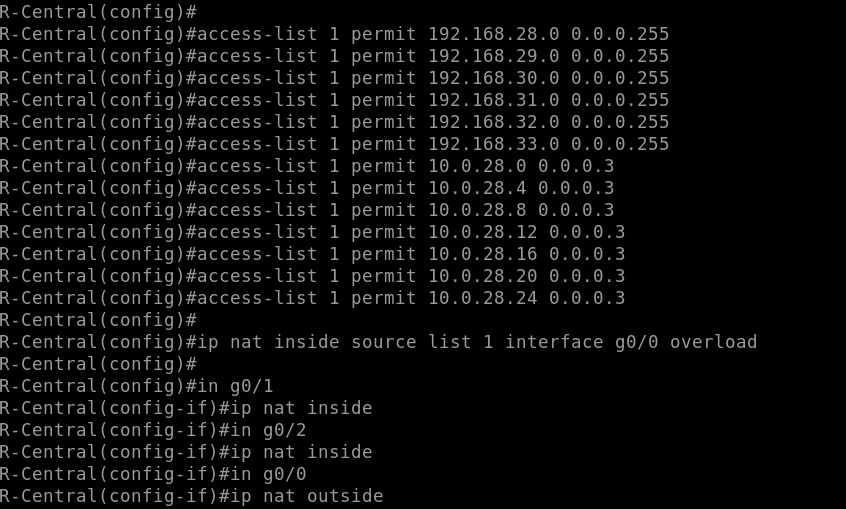
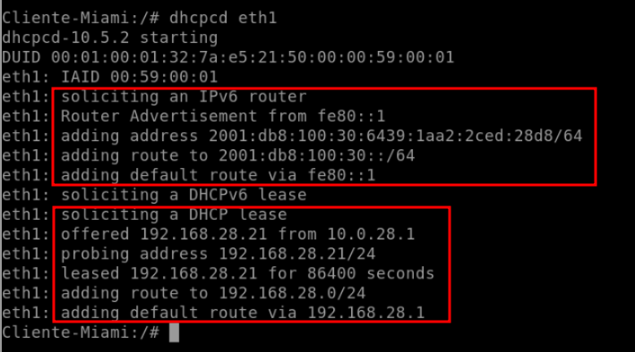
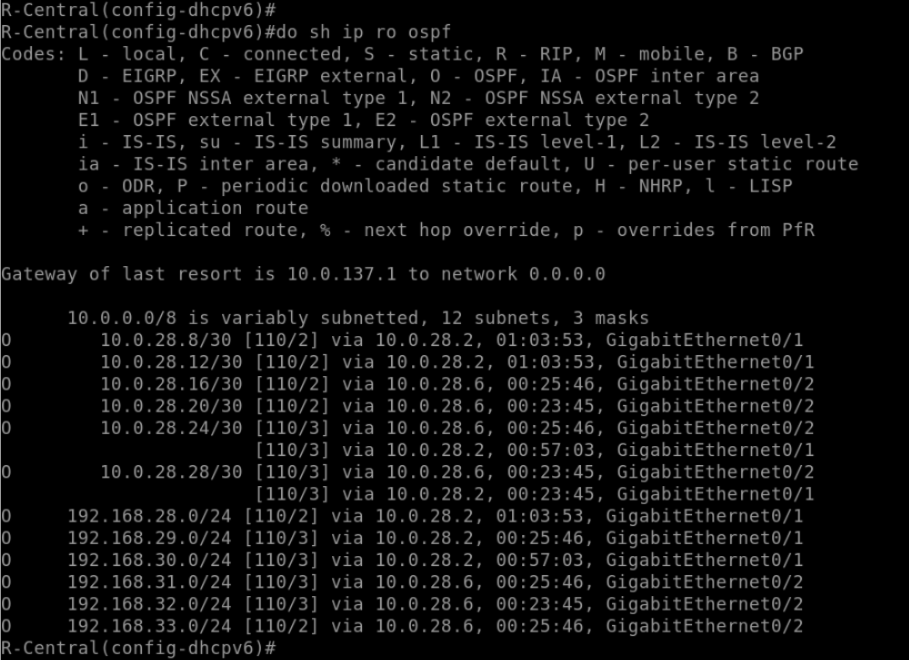
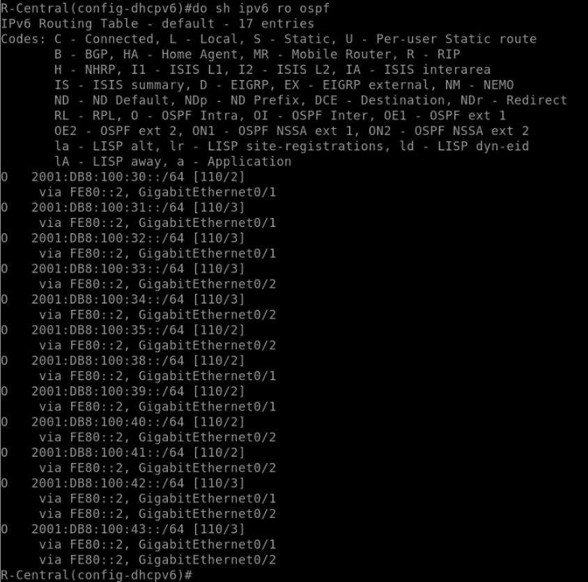
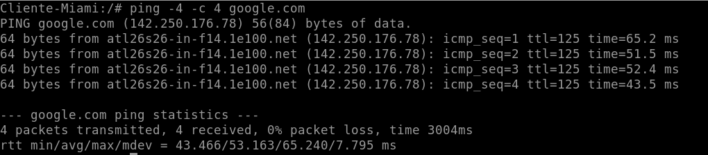

# 🌐 Laboratorio Dual Stack (IPv4 + IPv6) con OSPFv2 y OSPFv3

En este laboratorio se montó, en **PNET Lab** sobre **VMware**, una red de **7 routers** en la que IPv4 e IPv6 conviven (*dual stack*). Primero se segmentó la red con subnetting, después se habilitó el enrutamiento dinámico con **OSPFv2** y **OSPFv3**, y por último se centralizaron en `R-Central` los servicios de **DHCP** y la salida a Internet, que usa **PAT** para que las redes internas puedan alcanzar destinos IPv4 externos.

## 🛠️ Tecnologías utilizadas

## 📑 Contenido

1. [Objetivos](#-objetivos)
2. [Topología](#-topología)
3. [Plan de direccionamiento](#-plan-de-direccionamiento)
4. [Desarrollo de la práctica](#-desarrollo-de-la-práctica)
5. [Verificación](#-verificación)
6. [Observaciones y mejoras pendientes](#-observaciones-y-mejoras-pendientes)
7. [Conclusiones](#-conclusiones)

## 🎯 Objetivos

Con esta práctica se buscaba lograr lo siguiente:

- Implementar una topología **dual stack**, con direccionamiento IPv4 e IPv6 en todos los segmentos.
- Segmentar la red con **subnetting**: LANs /24 (IPv4) y /64 (IPv6), y enlaces entre routers /30 con su /64 IPv6.
- Enrutar con **OSPFv2** (IPv4) y **OSPFv3** (IPv6) entre los 7 routers.
- Centralizar **DHCPv4 y DHCPv6** en `R-Central`.
- Dar salida a redes IPv4 externas mediante **PAT** en `R-Central`.
- Preparar hosts Linux capaces de obtener direccionamiento IPv6 con `dhcpcd`.

## 🗺️ Topología

La red gira alrededor de `R-Central`, el único router con salida a Internet. A partir de él se fueron conectando los demás routers formando un anillo, y cada uno atiende una LAN con su switch y su cliente.

| Router | Router-ID OSPF | LAN que atiende |
|---|---|---|
| R-Central | 1.1.1.1 | Ninguna (núcleo y salida a Internet) |
| R-Miami | 2.2.2.2 | LAN-Miami |
| R-California | 3.3.3.3 | LAN-California |
| R-Boston | 4.4.4.4 | LAN-Boston |
| R-Washington | 5.5.5.5 | LAN-Washington |
| R-Missouri | 6.6.6.6 | LAN-Missouri |
| R-Chicago | 7.7.7.7 | LAN-Chicago |

## 📋 Plan de direccionamiento

Antes de configurar cualquier equipo se definió el plan de direccionamiento. Primero se asignaron los prefijos de las LANs y luego los de los enlaces entre routers.

### Redes LAN

| LAN | IPv4 | IPv6 |
|---|---|---|
| Miami | 192.168.28.0/24 | 2001:DB8:100:30::/64 |
| Washington | 192.168.29.0/24 | 2001:DB8:100:31::/64 |
| Boston | 192.168.30.0/24 | 2001:DB8:100:32::/64 |
| Missouri | 192.168.31.0/24 | 2001:DB8:100:33::/64 |
| Chicago | 192.168.32.0/24 | 2001:DB8:100:34::/64 |
| California | 192.168.33.0/24 | 2001:DB8:100:35::/64 |

### Enlaces entre routers

| Enlace | Interfaces | IPv4 | IPv6 |
|---|---|---|---|
| R-Central ↔ R-Miami | Gi0/1 ↔ Gi0/3 | 10.0.28.0/30 | 2001:DB8:100:36::/64 |
| R-Central ↔ R-California | Gi0/2 ↔ Gi0/3 | 10.0.28.4/30 | 2001:DB8:100:37::/64 |
| R-Miami ↔ R-Boston | Gi0/1 ↔ Gi0/2 | 10.0.28.8/30 | 2001:DB8:100:38::/64 |
| R-Miami ↔ R-Washington | Gi0/2 ↔ Gi0/2 | 10.0.28.12/30 | 2001:DB8:100:39::/64 |
| R-California ↔ R-Missouri | Gi0/1 ↔ Gi0/2 | 10.0.28.16/30 | 2001:DB8:100:40::/64 |
| R-California ↔ R-Chicago | Gi0/2 ↔ Gi0/2 | 10.0.28.20/30 | 2001:DB8:100:41::/64 |
| R-Boston ↔ R-Missouri | Gi0/1 ↔ Gi0/1 | 10.0.28.24/30 | 2001:DB8:100:42::/64 |
| R-Washington ↔ R-Chicago | Gi0/1 ↔ Gi0/1 | 10.0.28.28/30 | 2001:DB8:100:43::/64 |

## 🧪 Desarrollo de la práctica

1. **Se planificó la segmentación.** Lo primero fue el subnetting: a cada LAN se le asignó un /24 IPv4 y un /64 IPv6, y el bloque `10.0.28.0` se dividió en subredes /30, cada una con su /64 IPv6, para los 8 enlaces entre routers. El resultado es el plan de direccionamiento que se vio arriba.

2. **Se habilitó el enrutamiento dinámico.** Con el direccionamiento listo, se activaron OSPFv2 y OSPFv3 en los 7 routers usando los Router-ID de la tabla de la topología, y se anunciaron tanto las LANs como los enlaces punto a punto. Más adelante, en la verificación, se comprueba que todos los routers aprendieron las rutas.
   <!-- TODO: agregar captura y comandos de la configuración de OSPFv2/OSPFv3 -->

3. **Se reservaron direcciones en el DHCPv4.** Después se pasó a los servicios DHCP, que se centralizaron en `R-Central`. Lo primero fue reservar las primeras 20 direcciones de cada LAN con `ip dhcp excluded-address 192.168.28.1 192.168.28.20`, repitiendo el comando para las redes 192.168.29.x hasta 192.168.33.x. Así, los equipos reciben direcciones a partir de la `.21` y quedan libres las primeras para gateways y equipos con IP fija.

   

4. **Se crearon los pools DHCPv4.** Con las exclusiones listas, se creó un pool por LAN con `ip dhcp pool LAN-Miami` y, dentro de él, `network 192.168.28.0 255.255.255.0`, `default-router 192.168.28.1`, `dns-server 8.8.8.8` y `domain-name pnetlab.local`. Luego se repitió el proceso para Washington, Boston, Missouri, Chicago y California con sus redes y gateways. En la captura se ve un pequeño tropiezo: al configurar el pool de Boston se escribió `domainname` en lugar de `domain-name`, y se corrigió en el siguiente comando.

   

5. **Se crearon los pools DHCPv6.** Para IPv6 se hizo algo parecido: se creó un pool por LAN con `ipv6 dhcp pool LAN-Miami` y se le asignó `domain-name pnetlab.local`, repitiéndolo para Washington, Boston, Missouri, Chicago y California. Las direcciones IPv6 de los clientes se obtienen a partir de los Router Advertisement de cada LAN; los ajustes pendientes de estos pools están en la sección de observaciones.
   

7. **Se configuró PAT en R-Central.** Con DHCP resuelto, se preparó la salida a Internet. Primero se definió la ACL estándar que identifica el tráfico a traducir, con `access-list 1 permit 192.168.28.0 0.0.0.255` para cada LAN (hasta la red 192.168.33.0) y `access-list 1 permit 10.0.28.0 0.0.0.3` para los enlaces /30 desde `10.0.28.0` hasta `10.0.28.24`. Luego se aplicó la traducción con `ip nat inside source list 1 interface g0/0 overload`; en un primer intento se había escrito sin `overload`, así que se eliminó con el prefijo `no` y se aplicó de nuevo con la opción correcta. Por último se marcaron las interfaces: `ip nat inside` en `g0/1` y `g0/2`, y `ip nat outside` en `g0/0`, que es la salida hacia Internet.

   

8. **Se preparó la imagen de los hosts.** Para los clientes se usó una imagen derivada de *network-multitool* a la que se le instaló **`dhcpcd`**, porque la imagen original no permitía obtener direcciones IPv6 de forma predeterminada. La imagen resultante se publicó en Docker Hub como [`vonoo/dhcp-client`](https://hub.docker.com/r/vonoo/dhcp-client) y puede descargarse con `docker pull vonoo/dhcp-client`.

   
   <!-- TODO: agregar captura y comandos de la creación de la imagen (Dockerfile o instalación de dhcpcd) -->

9. **Se probó el direccionamiento desde un cliente.** Con todo lo anterior listo, se ejecutó `dhcpcd eth1` en `Cliente-Miami`. Por IPv6, el cliente recibió un Router Advertisement desde `fe80::1` y a partir de él configuró la dirección `2001:db8:100:30:6439:1aa2:2ced:28d8/64`, su ruta conectada y la ruta por defecto vía `fe80::1`. Por IPv4, recibió la oferta del servidor DHCP en `R-Central` (`10.0.28.1`) y obtuvo `192.168.28.21/24` por 86400 segundos (24 horas), con ruta por defecto vía `192.168.28.1`. Que la primera dirección entregada sea la `.21` confirma que las exclusiones del paso 3 funcionan.

   

## ✅ Verificación

Una vez configurado todo, se revisó que la red se comportara como se esperaba, empezando por las tablas de enrutamiento de `R-Central` y terminando con una prueba hacia Internet.

9. **Se revisaron las rutas OSPFv2.** En `R-Central` se ejecutó `show ip route ospf`. La tabla muestra la ruta por defecto (*gateway of last resort*) hacia `10.0.137.1` y 12 rutas aprendidas por OSPF: las 6 LANs y 6 enlaces punto a punto. Las redes `10.0.28.24/30` y `10.0.28.28/30` se alcanzan por dos caminos de igual costo (`Gi0/1` y `Gi0/2`), por lo que OSPF balancea la carga entre ambos.

   

10. **Se revisaron las rutas OSPFv3.** Luego se hizo lo mismo para IPv6 con `show ipv6 route ospf`, que muestra los 12 prefijos equivalentes (`2001:DB8:100:30::/64` a `2001:DB8:100:35::/64` y `2001:DB8:100:38::/64` a `2001:DB8:100:43::/64`), con siguiente salto `FE80::2` por `Gi0/1` y `Gi0/2`. Igual que en IPv4, los prefijos `2001:DB8:100:42::/64` y `2001:DB8:100:43::/64` tienen dos rutas de igual costo.

    

11. **Se probó la salida a Internet.** Para cerrar, desde `Cliente-Miami` se ejecutó `ping -4 -c 4 google.com`. Se enviaron 4 paquetes y se recibieron 4 (0% de pérdida), con un RTT promedio de 53.163 ms, lo que confirma que el PAT de `R-Central` permite a las LANs alcanzar redes IPv4 externas.

    

## 📌 Conclusiones

Al final, la topología dual stack quedó operativa: los 7 routers intercambian rutas IPv4 e IPv6 mediante OSPFv2 y OSPFv3. El subnetting permitió ordenar la red con un plan de direccionamiento consistente entre ambas pilas (por ejemplo, el enlace `10.0.28.24/30` corresponde a `2001:DB8:100:42::/64`). Centralizar el DHCP en `R-Central` simplificó la administración, y el PAT dio salida a redes IPv4 externas a todas las LANs a través de una sola interfaz, `g0/0`. Por último, instalar `dhcpcd` en la imagen de los hosts fue necesario para que los clientes Linux obtuvieran direccionamiento IPv6.

## 📁 Estructura del repositorio

- `README.md`: esta documentación.
- `imagenes/`: capturas de pantalla referenciadas en cada paso.
